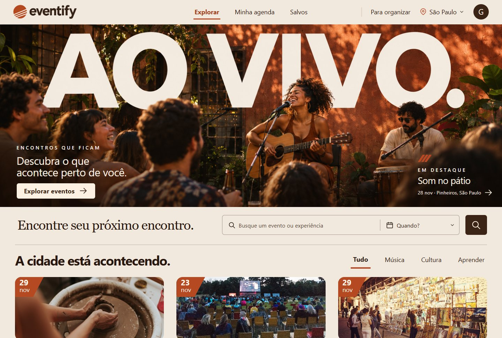

<h1 align="center">
  
</h1>

<p align="center">
  Descubra eventos pelo bairro, guarde seus ingressos e organize encontros locais da publicação ao check-in.
</p>

<p align="center">
  <a href="#como-rodar">Como rodar</a> ·
  <a href="#o-que-fazer-na-eventify">O que fazer</a> ·
  <a href="#como-contribuir">Como contribuir</a>
</p>



<details>
<summary>Ver a Eventify no celular</summary>

<p align="center">
  
</p>

</details>

## Como rodar

Você precisa de **Git**, **Node.js 24 ou superior** e um navegador atualizado. O projeto roda com os arquivos do repositório, sem instalar pacotes.

```bash
git clone https://github.com/GiulioFreitaS/Eventify.git
cd Eventify
node server.mjs
```

Abra [http://127.0.0.1:4173](http://127.0.0.1:4173) e mantenha o terminal aberto.

### Aplicativo Android

O APK roda no Android 10 ou superior. O [guia do Android](android/README.md) reúne os comandos para gerar e instalar o APK e abrir o diagnóstico.

<details>
<summary>Abrir no celular pela rede local</summary>

Com o PC e o celular no mesmo Wi-Fi, pare o servidor com `Ctrl+C` e execute:

```bash
node server.mjs --lan
```

No navegador do celular, abra o endereço que o terminal mostrar em **Celular na mesma rede**. Para instalação na tela inicial e uso offline no celular, a origem precisa ser HTTPS. O modo offline fica disponível após o primeiro carregamento completo em uma origem compatível.

</details>

<details>
<summary>Usar outra porta</summary>

No **PowerShell**:

```powershell
$env:EVENTIFY_PORT = '4180'
node server.mjs
```

No **Git Bash**:

```bash
EVENTIFY_PORT=4180 node server.mjs
```

Abra [http://127.0.0.1:4180](http://127.0.0.1:4180).

</details>

## O que fazer na Eventify

| Se você quer ir a um evento | Se você quer organizar um evento |
| --- | --- |
| **Explorar** por bairro, categoria e data. | **Criar e publicar** eventos pelo painel do organizador. |
| **Salvar** eventos para consultar depois. | **Consultar participantes** e exportar a lista em CSV. |
| **Inscrever-se e guardar ingressos** em Minha agenda. | **Fazer check-in** pelo código do ingresso e identificar entradas já registradas. |

### Experimente a demo

1. Em **Explorar**, abra o *Som no pátio* e confirme uma inscrição gratuita. Para testar pagamento simulado, escolha a *Oficina de cerâmica*.
2. Abra **Minha agenda**. Se houver mais de um ingresso do mesmo evento, deslize, use os botões ou pressione as setas para folhear. Você também pode baixar o ingresso em PNG.
3. Em **Para organizar → Check-in**, selecione o evento e cole o código do ingresso. Repita a operação para ver como a Eventify informa que a entrada já foi registrada.

Se a inscrição de um evento de exemplo já tiver encerrado, publique um evento com data futura para repetir o fluxo.

### Próxima etapa

O próximo passo é conectar o site e o app Android a um backend compartilhado. A API vai sincronizar contas, eventos e ingressos e validar a lotação e o check-in.

## Como o projeto funciona

O app usa **HTML, CSS e TypeScript**, com um servidor HTTP em **Node.js**. Eventos, perfis, favoritos, inscrições e check-ins ficam no **IndexedDB** de cada navegador ou instalação Android. A entrada é demonstrativa, e as opções de Pix e cartão simulam o pagamento sem cobrança.

| Onde mexer | O que fica ali |
| --- | --- |
| [`src/explore.ts`](src/explore.ts), [`src/participant.ts`](src/participant.ts) e [`src/organizer.ts`](src/organizer.ts) | Telas de descoberta, participante e organizador |
| [`src/model.ts`](src/model.ts) e [`src/repository.ts`](src/repository.ts) | Dados iniciais, inscrições, eventos, perfis e check-in |
| [`src/main.ts`](src/main.ts) e [`src/ui.ts`](src/ui.ts) | Rotas, ações e componentes compartilhados |
| [`styles.css`](styles.css) e [`mobile.css`](mobile.css) | Layout e estilos |
| [`server.mjs`](server.mjs), [`manifest.webmanifest`](manifest.webmanifest) e [`sw.js`](sw.js) | Servidor, instalação e acesso offline |

## Como contribuir

1. Crie um [fork da Eventify](https://github.com/GiulioFreitaS/Eventify/fork) na sua conta.
2. Clone o seu fork e crie uma branch para a tarefa. Troque `SEU_USUARIO` pelo seu usuário do GitHub.

   ```bash
   git clone https://github.com/SEU_USUARIO/Eventify.git
   cd Eventify
   git switch -c feat/minha-melhoria
   ```

3. Rode o app, teste o fluxo que você mudou e envie os commits para a sua branch no fork.
4. Abra um pull request com destino à `main` da Eventify. Conte o que mudou e como reproduzir o teste.

Antes de começar outra tarefa, atualize a `main` do seu fork com **Sync fork → Update branch** no GitHub.

## Créditos das imagens

A logo e a arte de abertura do desktop vêm do material da Eventify. As fotos ilustrativas são usadas sob a [licença do Pexels](https://www.pexels.com/license/).

| Onde aparece | Fotografia |
| --- | --- |
| Som no pátio | [Diana GP](https://www.pexels.com/photo/woman-singing-and-playing-on-guitar-on-a-street-15603500/) |
| Oficina de cerâmica | [Letícia Alvares](https://www.pexels.com/photo/hands-shaping-clay-on-pottery-wheel-in-studio-36717713/) |
| Cinema no terraço | [Son Tung Tran](https://www.pexels.com/photo/people-sitting-on-chairs-in-an-outdoor-cinema-6521573/) |
| Feira de arte independente | [AS Photography](https://www.pexels.com/photo/people-looking-at-assorted-type-paintings-1028636/) |
| Jazz no jardim | [Gustavo Anacleto](https://www.pexels.com/photo/photo-of-man-playing-saxophone-3364190/) |
| Tela de entrada | [Cristhian David Duarte](https://www.pexels.com/photo/woman-playing-the-guitar-and-singing-19138692/) |
| Capa do perfil | [Huỳnh Như Mavi](https://www.pexels.com/photo/cozy-outdoor-terrace-with-string-lights-and-greenery-37564033/) |
| Chamada para organizar | [A. S.](https://www.pexels.com/photo/close-up-shot-of-microphone-12092846/) |
